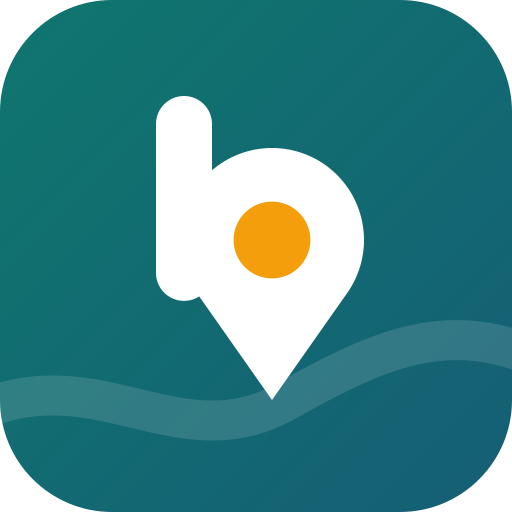

<div align="center">



# Better Maps

**Offline-Karten mit Öffentlichem Verkehr, Verkehrslage und „Jetzt geöffnet“, datensparsam von Anfang an.**

</div>

Better Maps ist eine freie Karten-App für Android auf Basis von [OpenStreetMap](https://www.openstreetmap.org). Sie ist
ein Fork von [CoMaps](https://codeberg.org/comaps/comaps) und ergänzt die Funktionen, die man von einer modernen
Karten-App erwartet. Der Offline- und Datenschutz-Anspruch des Originals bleibt dabei erhalten: Jede Online-Funktion
ist ausgeschaltet, bis man sie ausdrücklich einschaltet.

> Status: in Entwicklung, noch keine veröffentlichten Builds. Zielplattform ist Android; iOS und Desktop werden aus
> dem Upstream mitgebaut, aber nicht gepflegt.

## Was Better Maps zusätzlich kann

| Bereich | Funktion |
|---|---|
| **Suche** | Filter „Jetzt geöffnet“ (auch „auch ohne Öffnungszeiten“), Anfragen wie „Apotheke Sonntag“ oder „Café offen“, besseres Ranking für Kategorien, rund 130 deutsche Alltagsbegriffe („Frühstück“ → Café) |
| **Online-Suche** | Optionale Ergänzung über [Photon](https://github.com/komoot/photon) für Regionen ohne heruntergeladene Karte |
| **Öffentlicher Verkehr** | Verbindungen mit Fahrplan und Echtzeit im Routenplaner, Abfahrten in der Ortsansicht, Einstellungen für Umsteigezeit, Gehgeschwindigkeit, Barrierefreiheit und Fahrrad; über [Transitous](https://transitous.org) oder einen eigenen [MOTIS](https://github.com/motis-project/motis)-Server |
| **Verkehrslage** | Staus, Sperrungen und Baustellen im Format [TraFF](https://github.com/traff-xml) auf der Karte und im Auto-Routing; Daten aus der Autobahn-API und DATEX II |
| **Stauerkennung** | Freiwilliger, anonymer Beitrag aus der Navigation: verrauscht auf dem Gerät, verschlüsselt über Oblivious HTTP, veröffentlicht erst ab einer Mindestzahl an Meldungen |

Dazu kommt alles, was CoMaps mitbringt: Offline-Karten weltweit, Routen für Auto, Rad und Fuß, Lesezeichen und
Tracks, Bearbeiten von OpenStreetMap-Daten.

## Aufbau des Repos

| Pfad | Inhalt |
|---|---|
| `android/`, `libs/`, `data/` | Die App (C++-Kern, Android-Oberfläche), weitgehend wie in CoMaps |
| [`services/traff-server`](services/traff-server/README.md) | Verkehrsdaten-Server (Go): Autobahn-API, DATEX II, Crowd-Daten → TraFF |
| [`services/crowd-traffic`](services/crowd-traffic/README.md) | Aggregations-Server für die anonyme Stauerkennung (Go, OHTTP) |
| [`services/motis`](services/motis/README.md) | Eigener ÖPNV-Routing-Server (MOTIS, Podman) |
| [`docs/BETTER_MAPS_BUILD.md`](docs/BETTER_MAPS_BUILD.md) | Bauen, Testen, Emulator |
| [`docs/CROWD_TRAFFIC_PRIVACY.md`](docs/CROWD_TRAFFIC_PRIVACY.md) | Datenschutz-Design der Stauerkennung |
| [`docs/PHOTON.md`](docs/PHOTON.md) | Eigener Photon-Server für die Online-Suche |
| [`FEATURES.md`](FEATURES.md), [`IMPLEMENTATION_PLAN.md`](IMPLEMENTATION_PLAN.md) | Geplante Funktionen und Umsetzungsstand |
| [`docs/branding`](docs/branding) | Logo (SVG/PNG); alle App-Icons erzeugt `tools/better-maps/branding/generate_icons.py` |

## Bauen

Kurzfassung (Details und Voraussetzungen in [docs/BETTER_MAPS_BUILD.md](docs/BETTER_MAPS_BUILD.md)):

```bash
git clone --recurse-submodules --shallow-submodules git@github.com:WayneNani/better-maps.git
cd better-maps
./configure.sh
tools/better-maps/bm.sh android-build      # Debug-APK, x86_64
tools/better-maps/bm.sh android-unit       # JVM-Tests
```

Für ein Gerät mit ARM-Prozessor statt `-Px86_64` die passende Architektur bauen, z. B.
`cd android && ./gradlew -Parm64 assembleFdroidDebug`.

## Online-Dienste und Datenschutz

Better Maps funktioniert vollständig offline. Online-Funktionen sind einzeln abschaltbar und standardmäßig aus.
Welche Daten an welchen Dienst gehen, steht in [PRIVACY.md](PRIVACY.md).

Für den regelmäßigen Betrieb sollten eigene Server verwendet werden: Die öffentlichen Instanzen von Transitous und
Photon sind nur für geringe Last gedacht. Kartendateien werden weiterhin von den Servern von CoMaps geladen.

## Herkunft und Lizenz

Better Maps ist ein Fork von [CoMaps](https://codeberg.org/comaps/comaps), das wiederum auf
[Organic Maps](https://organicmaps.app) und MAPS.ME zurückgeht. Herzlichen Dank an alle, die daran mitgearbeitet
haben. Fehlerkorrekturen, die auch Upstream nützen, sollen dorthin zurückfließen.

Der Code steht unter der [Apache License 2.0](LICENSE); siehe auch [NOTICE](NOTICE) und
[data/copyright.html](data/copyright.html). Kartendaten © OpenStreetMap-Mitwirkende, lizenziert unter der
[ODbL](https://opendatacommons.org/licenses/odbl/).

„CoMaps“, „Organic Maps“ und die zugehörigen Logos sind Namen und Marken ihrer jeweiligen Projekte; Better Maps
verwendet eigene Namen und ein eigenes Logo.
